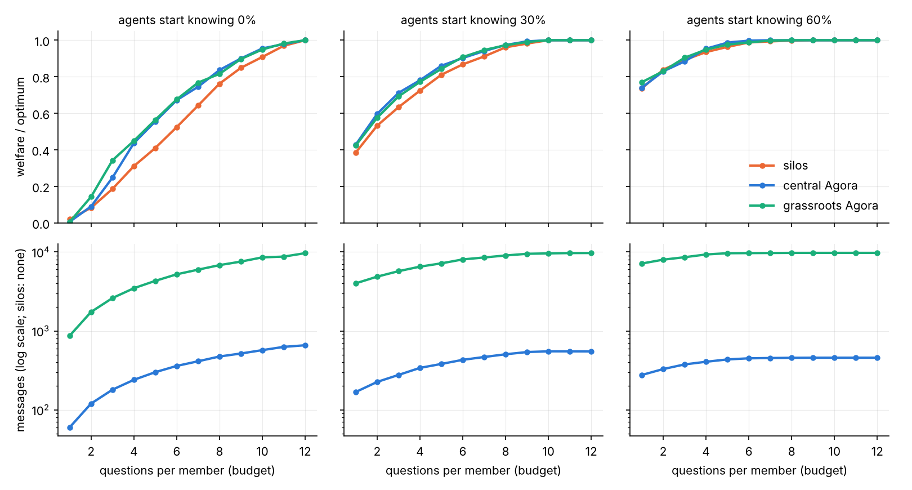

# AI-Agora

A framework for playing with AI-Agora: each member of a community has a personal agent, and the agents organize the community together — form groups, then decide and divide.

The code follows the basic model of the AI-Agora position paper and the BSF proposal, so what is simulated is what the theory talks about.

## Status
Forming groups (single membership, a minimum group size), simulated members, rule-based agents, measured against the exact optimum, in three settings:
- **silos** — each agent asks its member alone, then reports once to a mechanism;
- **central Agora** — a coordinator directs the questions (`central`, and a smarter `central-smart`);
- **grassroots Agora** — no coordinator; the simplest protocol replicates the coordinator at every agent (all agents broadcast, all compute the same plan, so they always agree).

`agora/benchmarks.py` has a reference point that already knows how popular each initiative is.



**Live:** https://talmonlab.bgu.ac.il/agora/ — an explainer in slides on the simplest case (`web/deck/src/build.py`, zutot deck engine); https://talmonlab.bgu.ac.il/agora/play — the playground for forming groups (`web/viewer.html`).

**Simplest model ("pick one"):** `agora/pick_one.py`; paper seed in `paper/` (`main.tex`, `main.pdf`): silos guarantee exactly questions/options of the best; sharing reaches the best on hidden-favorite instances; figure from `experiments/pick_one_plot.py`.

## Run
```
pip install -r requirements.txt
python -m agora.run --setting central --budget 4 --informed 0.3 --out runs/one.json
python experiments/sweep.py --seeds 20 --out runs/sweep1
python experiments/plot_sweep.py runs/sweep2.csv
python -m agora.replay --budget 6 --out runs/replay.html
```

## Layout
- `agora/model.py` — the instance: true acceptance sets, minimum group size, agents' initial estimates
- `agora/engine.py` — synchronous rounds, locality (each policy sees only its own view), the event log and costs
- `agora/tasks/groups.py` — welfare, feasibility, exact optimum (ILP)
- `agora/protocols/` — one file per setting
- `agora/data/synthetic.py` — the neighborhood generator
- `agora/replay.py`, `web/viewer.html` — replay frames and the viewer
- `experiments/` — sweeps and plots

## Plan
1. P0 — forming groups: silos, central, grassroots; replay viewer *(now)*
2. P1 — smarter grassroots protocols; federating groups into larger communities; deciding and dividing
3. P2 — web app on talmonlab (`/agora`): replay runs *(done)*, then play mode with real people
4. P3 — LLM agents and LLM members
5. P4 — the full chain: form groups, found a constitution, decide, divide, federate
