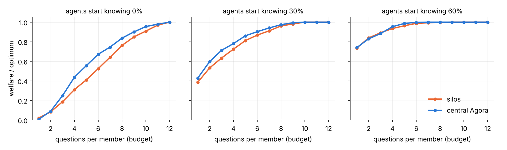

# AI-Agora

A framework for playing with AI-Agora: each member of a community has a personal agent, and the agents organize the community together — form groups, then decide and divide.

The code follows the basic model of the AI-Agora position paper and the BSF proposal, so what is simulated is what the theory talks about.

## Status
P0: forming groups (single membership, a minimum group size), simulated members, rule-based agents, two settings — **silos** and a **central Agora** — measured against the exact optimum.



## Run
```
pip install -r requirements.txt
python -m agora.run --setting central --budget 4 --informed 0.3 --out runs/one.json
python experiments/sweep.py --seeds 20 --out runs/sweep1
python experiments/plot_sweep.py runs/sweep1.csv
```

## Layout
- `agora/model.py` — the instance: true acceptance sets, minimum group size, agents' initial estimates
- `agora/engine.py` — synchronous rounds, locality (each policy sees only its own view), the event log and costs
- `agora/tasks/groups.py` — welfare, feasibility, exact optimum (ILP)
- `agora/protocols/` — one file per setting
- `agora/data/synthetic.py` — the neighborhood generator
- `experiments/` — sweeps and plots

## Plan
1. P0 — forming groups: silos vs central *(now)*
2. P1 — grassroots Agora; federating groups into larger communities; deciding and dividing
3. P2 — web app on talmonlab (`/agora`): replay runs, then play mode with real people
4. P3 — LLM agents and LLM members
5. P4 — the full chain: form groups, found a constitution, decide, divide, federate
